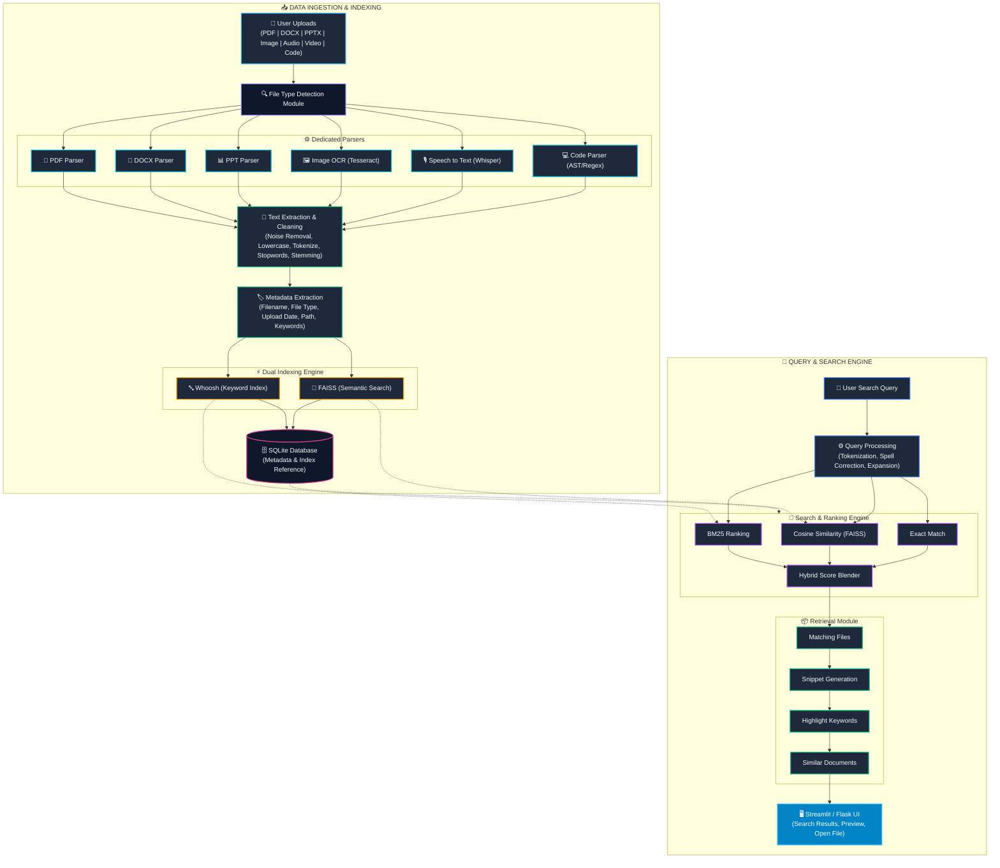

# ⚡ OmniSearch AI: Multi-Format Document Search Engine

An AI-powered document ingestion, indexing, and hybrid search system designed for multi-format documents.

---

## 🏛️ System Architecture

```text
                    +----------------------+
                    |      User Uploads    |
                    |----------------------|
                    | PDF | DOCX | PPTX    |
                    | Image | Audio | Video|
                    | Source Code          |
                    +----------+-----------+
                               |
                               v
                +-----------------------------+
                | File Type Detection Module  |
                +-----------------------------+
                               |
        -----------------------------------------------------
        |        |          |         |         |           |
        v        v          v         v         v           v

    PDF Parser  DOCX      PPT Parser Image OCR  Speech      Code Parser
                Parser                (Tesseract) to Text   (AST/Regex)
                                               (Whisper)

        -----------------------------------------------------
                               |
                               v
                 +-----------------------------+
                 | Text Extraction & Cleaning  |
                 |-----------------------------|
                 | Remove Noise                |
                 | Tokenization                |
                 | Lowercase                   |
                 | Stopword Removal            |
                 | Stemming/Lemmatization      |
                 +-------------+---------------+
                               |
                               v
                 +-----------------------------+
                 | Metadata Extraction Module  |
                 |-----------------------------|
                 | Filename                    |
                 | File Type                   |
                 | Upload Date                 |
                 | Path                        |
                 | Keywords                    |
                 +-------------+---------------+
                               |
                               v
                 +-----------------------------+
                 | Indexing Engine             |
                 |-----------------------------|
                 | Whoosh (Keyword Index)      |
                 | or                          |
                 | FAISS (Semantic Search)     |
                 +-------------+---------------+
                               |
                               v
                      +------------------+
                      | SQLite Database  |
                      |------------------|
                      | Metadata         |
                      | Index Reference  |
                      +---------+--------+
                                |
=============================================================
                                |
                                v
                       User Search Query
                                |
                                v
                  +-----------------------------+
                  | Query Processing            |
                  |-----------------------------|
                  | Tokenization                |
                  | Spell Correction (Optional) |
                  | Query Expansion (Optional)  |
                  +-------------+---------------+
                                |
                                v
                 +------------------------------+
                 | Search & Ranking Engine      |
                 |------------------------------|
                 | BM25 Ranking                 |
                 | Cosine Similarity (FAISS)    |
                 | Exact Match                  |
                 +-------------+----------------+
                               |
                               v
                 +-----------------------------+
                 | Retrieval Module            |
                 |-----------------------------|
                 | Matching Files              |
                 | Snippet Generation          |
                 | Highlight Keywords          |
                 | Similar Documents           |
                 +-------------+---------------+
                               |
                               v
                    +----------------------+
                    | Streamlit / Flask UI |
                    |----------------------|
                    | Search Results       |
                    | Preview              |
                    | Open File            |
                    +----------------------+


---

## ✨ Features

- **Multi-Format Document Parsing**:
  - **PDF**: Page-by-page text, table extraction, and metadata (`pypdf` / native stream parser).
  - **DOCX**: Headings, paragraphs, and tables (`python-docx` / XML parser).
  - **PPTX**: Slides, shapes, speaker notes, and tables (`python-pptx` / XML parser).
  - **Images**: OCR extraction using `pytesseract` with contrast enhancement.
  - **Audio & Video**: Speech-to-text transcription via `OpenAI Whisper`.
  - **Source Code**: Python AST parser for functions, classes, docstrings, and imports, plus regex tokenizer for JS, TS, Java, C/C++, Go, Rust, HTML, SQL, etc.
- **NLP Preprocessing**:
  - Noise & HTML tag removal.
  - Sentence & word tokenization.
  - Stopword filtering with built-in English stopwords.
  - Porter stemming & lemmatization.
- **Metadata & Storage**:
  - SQLite database storing filenames, paths, categories, checksums, timestamps, and keyword relations.
  - Automated keyword extraction using TF-IDF term frequency analysis.
- **Dual Indexing**:
  - **BM25 Keyword Index**: Powered by Whoosh / inverted index.
  - **FAISS Semantic Index**: Dense embeddings (`sentence-transformers/all-MiniLM-L6-v2`) with cosine similarity.
- **Hybrid Search & Ranking Engine**:
  - Blends BM25, Semantic Cosine Similarity, and Exact Substring Matches.
  - Supports 4 search modes: `Hybrid`, `Semantic`, `Keyword`, and `Exact`.
  - Spell correction & query expansion.
- **Retrieval & Highlighting**:
  - Context-aware snippets centered around matching terms.
  - HTML & Markdown keyword highlighting.
  - Similar document recommendations using vector nearest neighbors.
- **Streamlit Web UI & CLI**:
  - Drag-and-drop multi-file upload with progress bars.
  - Interactive search bar with instant results, filters, preview expander, and file download.
  - Document library and system analytics dashboard.
  - Full CLI fallback interface.

---

## 📁 Project Structure

```text
OmniSearch AI/
├── app.py                     # Streamlit application entrypoint & CLI runner
├── config.py                  # Global configurations and path constants
├── requirements.txt           # Project dependencies
├── README.md                  # Documentation and architecture guide
│
├── data/                      # Data storage directory
│   ├── uploads/               # Raw uploaded documents
│   ├── extracted_text/        # Plaintext extractions
│   └── indexes/               # BM25 and FAISS index files
│
├── database/                  # Database management
│   ├── metadata.db            # SQLite database
│   ├── schema.py              # DDL schema definitions
│   └── database.py            # Thread-safe SQLite CRUD manager
│
├── extractors/                # Multi-format parsers
│   ├── __init__.py            # Extractor registry and factory
│   ├── pdf_parser.py          # PDF parser
│   ├── docxx_parser.py        # Word DOCX parser
│   ├── ppt_parser.py          # PowerPoint PPTX parser
│   ├── image_ocr.py           # Tesseract OCR parser
│   ├── audio_transcriber.py   # Whisper audio speech-to-text
│   ├── video_transcriber.py   # Video audio extraction & transcription
│   └── code_parser.py         # AST and regex code parser
│
├── preprocessing/             # NLP text cleaning pipeline
│   ├── __init__.py            # End-to-end preprocessing function
│   ├── text_cleaner.py        # Noise and HTML removal
│   ├── tokenizer.py           # Word and sentence tokenization
│   ├── stopwords.py           # Stopword filtering
│   └── stemmer.py             # Porter stemmer and lemmatizer
│
├── metadata/                  # Metadata and keyword extraction
│   ├── __init__.py            # Metadata package init
│   └── metadata_extractor.py  # Metadata compilation & TF-IDF keywords
│
├── indexing/                  # Dual indexing engine
│   ├── __init__.py            # Unified IndexManager
│   ├── whoosh_index.py        # Whoosh / BM25 keyword index
│   └── faiss_index.py         # FAISS / NumPy semantic vector index
│
├── search/                    # Search and ranking engine
│   ├── __init__.py            # Search package init
│   ├── query_processor.py     # Query cleaning, spelling & expansion
│   ├── bm25_ranker.py         # BM25 scoring & normalization
│   ├── similarity.py          # Vector cosine similarity
│   └── search_engine.py       # Hybrid ranking & filtering
│
├── retrieval/                 # Retrieval & snippet generation
│   ├── __init__.py            # Retrieval package init
│   ├── snippet_generator.py   # Context-aware text windowing
│   ├── highlighter.py         # Keyword highlighting (<mark> / **)
│   └── result_retriever.py    # Result enrichment & similar docs
│
├── ui/                        # Streamlit UI components
│   ├── __init__.py            # UI package init
│   ├── upload_page.py         # Document upload and batch ingestion
│   ├── search_page.py         # Search bar and filter controls
│   └── result_display.py      # Result cards and snippet rendering
│
├── utils/                     # Utility modules
│   ├── __init__.py            # Utils package init
│   ├── file_detector.py       # MIME and magic-byte category detection
│   ├── file_manager.py        # Storage, checksums, and text cache
│   └── logger.py              # Centralized logging setup
│
└── tests/                     # Unit and integration test suite
    ├── test_extractors.py     # Parser tests
    ├── test_preprocessing.py  # Cleaning and tokenization tests
    ├── test_indexing.py       # BM25 and FAISS index tests
    ├── test_search.py         # Search engine and ranking tests
    └── test_retrieval.py      # Snippet and highlighter tests
```

---

## 🚀 Quickstart & Usage

### 1. Installation

```bash
# Clone or navigate to the directory
cd "OmniSearch AI"

# Install Python dependencies
pip install -r requirements.txt
```

*(Optional for OCR)* Install Tesseract OCR:
- **macOS**: `brew install tesseract`
- **Ubuntu/Debian**: `sudo apt install tesseract-ocr`

### 2. Launch the Streamlit Web UI

```bash
streamlit run app.py
```

Open your browser to `http://localhost:8501`.

### 3. Command Line Interface (CLI) Search

You can also run searches directly from your terminal:

```bash
python3 app.py "quantum computing"
```

### 4. Running the Test Suite

```bash
python3 -m unittest discover -s tests -p "test_*.py" -v
```
